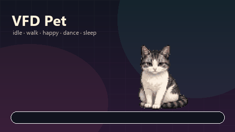

# VFD Pet

Michi en pixel art para Spotify, dibujado a partir de una gata real: te sigue con el cursor, duerme en la barra de progreso,
se acicala, se estira, baila y reacciona cuando pausas o cambias de pista.

Es una extensión de Spicetify de **un solo archivo**, sin dependencias en runtime y **sin assets
remotos**: la hoja de sprites va incrustada como data URI. No necesita conexión para funcionar.



## Qué trae

| | |
|---|---|
| Arte | **80×80 px** por frame, sacado de 16 poses de referencia de una gata real; PNG indexado con transparencia |
| Frames | **82** distintos en una cuadrícula de 8×11: las 16 poses reales y sus derivadas, más vistas generadas con PixelLab a partir de ellas (caminata de frente y de espaldas, levantarse, acicalarse, saltar); las animaciones comparten frames |
| Animaciones | **30**: idle, blink, alert, sit, 8 direcciones de caminata, sleep, tired, scratchSelf, 4 scratch de pared, drag, happy, groom, yawn, stretch, dos bailes (dance, danceJump) y las transiciones lieDown / wakeUp / getUp / sitDown |
| Variantes | **4** sin duplicar la hoja: Miel, Noche, Menta y Fresa (filtros CSS) |
| Acciones | acariciar, dormir/despertar, acicalarse, bailar, estirarse, centrar y ajustes |
| Persistencia | posición, variante, escala, velocidad, preferencias, mimos y estado de sueño |
| Offline | sí; el PNG está dentro del JS |
| Runtime | `requestAnimationFrame` en cada fotograma, aceleración y frenada, caminata por distancia, duración por frame, `transform: translate3d` ajustado a píxeles del dispositivo |

## Instalación

Requiere Spotify de escritorio y Spicetify en el `PATH`. Probado en Windows 11 con Spotify
1.2.89.539 y Spicetify 2.45.1.

```powershell
cd C:\Users\Mario\Downloads\VFD\pet
node tools\build.js
powershell -NoProfile -ExecutionPolicy Bypass -File .\scripts\install.ps1
```

`install.ps1` copia `Extensions\vfdPet.js` a `%APPDATA%\spicetify\Extensions`, lo añade a
`extensions` y ejecuta `spicetify apply`. **Spotify se reinicia**; avisa antes si estás
escuchando algo.

En este equipo la política de ejecución bloquea los `.ps1` y `npm.ps1`; por eso los comandos usan
`-ExecutionPolicy Bypass` y `npm.cmd`. `node tools\build.js` no necesita npm.

### Desinstalación

```powershell
powershell -NoProfile -ExecutionPolicy Bypass -File .\scripts\uninstall.ps1
```

Quita `vfdPet.js` de la lista de extensiones, borra el archivo y vuelve a aplicar. No toca otras
extensiones ni el tema activo.

### Desarrollo sin Spotify

Abre `dev/harness.html` en un navegador. El harness simula `Spicetify`, la barra de reproducción y
permite disparar acciones sin reiniciar Spotify. Los botones de la esquina superior derecha
muestran el estado (`mode`, `anim`, `frame`, posición y mimos).

## Controles

| Acción | Cómo |
|---|---|
| Acariciar | Clic sobre el michi. Sale la animación `happy` y suben los mimos. |
| Dormir / despertar | Doble clic sobre el michi. Si hay barra de progreso, camina hasta ella y se tumba encima. |
| Arrastrar | Mantén pulsado y mueve. Al soltar vuelve a su rutina. |
| Menú | Clic derecho sobre el michi. |
| Ajustes | Menú → Ajustes…, o escribe `michi` / `vfdpet` en el cliente. |
| Teclado | Con el michi enfocado: `Enter`/`Espacio` acaricia, `S` duerme/despierta, `Esc` cierra el menú. |

Si la barra no existe (tema, versión de Spotify o pantalla de inicio), duerme en la esquina
inferior derecha. La posición se recalcula al redimensionar la ventana.

## Ajustes

- **Tamaño**: 1× a 3× (80 a 240 px).
- **Velocidad**: 40 a 260 px/s.
- **Seguir al cursor**: si se desactiva, se queda quieto.
- **Dormir en la barra**: fallback seguro a la esquina.
- **Acciones automáticas**: cada 10–26 s elige entre sentarse, acicalarse, bostezar, estirarse,
  rascarse o dormirse.
- **Reaccionar a Spotify**: alerta al cambiar de pista; si pausas 20 s, bosteza.
- **Reducir movimiento**: limita las animaciones a 4 fps y desactiva las automáticas. También se
  activa por defecto si el sistema tiene `prefers-reduced-motion: reduce` y no hay ajustes guardados.

Las claves de `localStorage` son `vfdpet:settings:v1` y `vfdpet:state:v1`.

## Estructura

| Archivo | Papel |
|---|---|
| `src/vfdPet.js` | Fuente única: lógica pura exportada + runtime de Spicetify. Lleva marcadores `__SPRITE_META__` y `__SPRITE_URI__`. |
| `Extensions/vfdPet.js` | Artefacto generado y listo para instalar. Es el que se publica. |
| `assets/source/reference.png` | Referencia original: 16 poses en 4×4 sobre un damero pintado (sin alfa). |
| `assets/pet/spritesheet.png` | Hoja de 640×880, frames de 80×80, PNG indexado con transparencia. |
| `assets/pet/animations.json` | Mapa de animaciones: frames `[col, row]`, fps y loop. |
| `assets/pet/contact-sheet.png` | Contacto de las 30 animaciones, para revisar el arte. |
| `assets/source/pixellab/` | Frames generados con PixelLab desde la referencia, tal como se descargaron (`<carpeta>/<i>.png`). |
| `assets/preview/preview.png` / `.gif` | Preview de Marketplace y README. |
| `tools/import_sprites.py` | Recorta la referencia, deriva las poses que faltan y genera hoja, mapa, previews y contacto. |
| `tools/generate_sprites.py` | Generador procedural antiguo; hoy aporta los adornos (corazones, notas, `z`) y la tipografía de las previews. |
| `tools/build.js` | Valida el mapa, incrusta el PNG y escribe `Extensions/vfdPet.js`. |
| `tests/logic.test.js` | 22 pruebas de la lógica pura. |
| `tests/assets.test.js` | 9 pruebas de dimensiones, frames, data URI, manifest y licencias. |
| `dev/harness.html` | Simulador de Spicetify para ver el michi en un navegador. |
| `scripts/install.ps1` / `uninstall.ps1` | Instalación y retirada. |
| `scripts/dev.ps1` | Build + copia a Spicetify sin aplicar. |
| `scripts/measure.ps1` | Tamaños frente al presupuesto. |
| `scripts/cdp.js` | Cliente CDP mínimo para Spotify con `--remote-debugging-port=9222`. |
| `scripts/smoke.ps1` | Comprueba que la extensión montó, frames de 80×80 y 30 animaciones. |

## Build y pruebas

```powershell
# Regenerar el arte (necesita Pillow y numpy)
python -m pip install -r tools\requirements.txt
python tools\import_sprites.py

# Regenerar la extensión
node tools\build.js

# Pruebas
npm.cmd test
```

`build.js` falla si falta una animación, si un frame se sale de la cuadrícula, si el PNG no mide
columnas × filas del mapa o si la extensión supera 300 KiB. También comprueba que no queden marcadores sin sustituir.

Salida actual:

```text
sheet: 640x880 (91037 B)
frames: 82 in 30 animations
extension: Extensions\vfdPet.js (184103 B, budget 307200 B)
```

### Desarrollo y smoke

```powershell
# Build + copia a %APPDATA%\spicetify\Extensions, sin reiniciar Spotify
.\scripts\dev.ps1

# Build + copia + spicetify apply (reinicia Spotify)
.\scripts\dev.ps1 -Apply

# Instalar dejando CDP en 127.0.0.1:9222 para el smoke
powershell -NoProfile -ExecutionPolicy Bypass -File .\scripts\install.ps1 -DebugPort

# Comprobar que montó, frames de 80×80, 30 animaciones y PNG incrustado
powershell -NoProfile -ExecutionPolicy Bypass -File .\scripts\smoke.ps1
```

`smoke.ps1` usa `scripts/cdp.js` y espera exactamente una pestaña de Spotify. Si usas otro puerto,
exporta `CDP_PORT` antes de llamarlo. El smoke no cambia ajustes ni reinicia nada.

El harness acepta escenarios por hash: `#sleep`, `#menu`, `#settings`, `#drag` o cualquier nombre de
animación (`#dance`, `#groom`, `#yawn`). Con `?qa=1` conduce `requestAnimationFrame` con timers,
útil para capturas headless donde rAF solo pinta un frame.

## Cómo está hecho

- **Un solo archivo en runtime.** Spicetify copia solo el `.js`; por eso el PNG se incrusta como
  `data:image/png;base64`. No hay `fetch`, `raw.githubusercontent.com` ni caché que se rompa.
- **Hoja de sprites + `background-position`.** Cada frame es una celda de 80×80; el runtime mueve
  la posición del fondo con `framePosition`.
- **Lógica pura separada.** `clamp`, `direction8`, `stepToward`, `pickSleepSpot`, `advanceFrame`,
  `sanitizeSettings`, etc. se exportan con `module.exports` y se prueban en Node sin DOM.
- **Sueño seguro.** `pickSleepSpot` recibe rectángulos ya medidos y devuelve un punto válido; si no
  hay barra usa la esquina. Nunca hace `getBoundingClientRect()` sobre un selector nulo.
- **Ciclo de vida.** `requestAnimationFrame` con acumulador; se pausa con `document.hidden`; los
  listeners se registran una vez. `destroy()` está expuesto para pruebas.
- **UI sin React.** Menú y ajustes son DOM plano con variables CSS de Spicetify (`--spice-*`).
  Si `PopupModal` no existe o falla, hay un modal de respaldo.
- **Accesibilidad.** `role="button"`, `tabindex`, `aria-label`, foco visible, `Esc` para cerrar y
  respeto por `prefers-reduced-motion`.

### Cambiar el arte

1. Sustituye `assets/source/reference.png` por otra hoja de 4×4 poses con la misma disposición
   (echada, caminando hacia la izquierda, sentada, dormida) sobre damero o fondo claro neutro.
2. Ejecuta `python tools\import_sprites.py`. Falla de forma explícita si no encuentra 4 filas o si
   una pose no cabe en 80×80.
3. Para cambiar qué frames usa cada animación, edita `build_frames()` en `import_sprites.py`.
4. Ejecuta `node tools\build.js`. El build valida que todos los frames existan y estén en rango.

La caminata solo tiene vista lateral: hacia la derecha se usa el espejo, y al subir o bajar el runtime
conserva la última orientación horizontal. Acicalarse, estirarse, bostezar, bailar, rascarse y
arrastrar son poses derivadas de las reales (espejo, inclinación y adornos), no dibujos nuevos.

## Publicar en Marketplace

1. Sube el repo a GitHub con el topic `spicetify-extensions`.
2. Mantén `manifest.json` en la raíz con `name`, `description`, `preview`, `main`, `readme` y tags.
3. Verifica que `Extensions/vfdPet.js` esté commiteado: Marketplace descarga ese archivo, no ejecuta
   tu build.
4. No necesitas GitHub Pages: el arte va dentro del JS.

## Limitaciones conocidas

- Los selectores de la barra de progreso pueden cambiar entre versiones de Spotify; el fallback a
  la esquina evita errores, pero el michi no se tumbaría exactamente sobre la barra.
- Las variantes son filtros CSS sobre la misma hoja; no cambian el arte, solo el color.
- Probado en Windows 11 + Spotify 1.2.89.539 + Spicetify 2.45.1. No probado en macOS/Linux.
- El doble toque en pantallas táctiles no está garantizado; usa el menú contextual o los ajustes.
- El GIF de preview pesa ~420 KB; la extensión no lo carga.
- Las poses derivadas son aproximaciones; ver `PLAN-sprites.md` para el arte que falta.
- La hoja usa paleta indexada de 256 colores: error medio ~2/255 por canal frente al recorte original.

## Verificación pendiente

- Instalar en Spotify y comprobar el ciclo completo: chase, drag, sueño en la barra, menú,
  ajustes, `michi`, cambio de pista y pausa.
- Revisar en un tema claro y en uno oscuro que el menú y el modal usan bien `--spice-*`.
- Medir CPU con la ventana visible (`scripts/cdp.js perf 20`).

## Atribución y licencia

VFD Pet es una implementación independiente inspirada en **oneko.js** (adryd, MIT) y
**spicetify-oneko** (kyrie25, MIT). No se ha copiado código ni arte de esos proyectos; la hoja de
sprites sale de `assets/source/reference.png` (la gata del autor) mediante `tools/import_sprites.py`. El concepto del gato que sigue al
cursor viene del Neko original (1989).

Código y arte de este repo: MIT, © 2026 VFD Pet contributors. Ver `LICENSE` y
`LICENSE-NOTICE.md`. No está afiliado a Spotify, Spicetify, adryd ni kyrie25.
